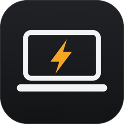
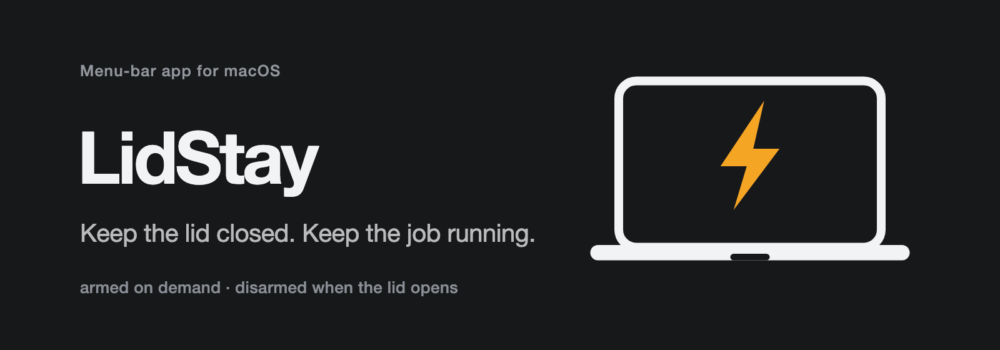
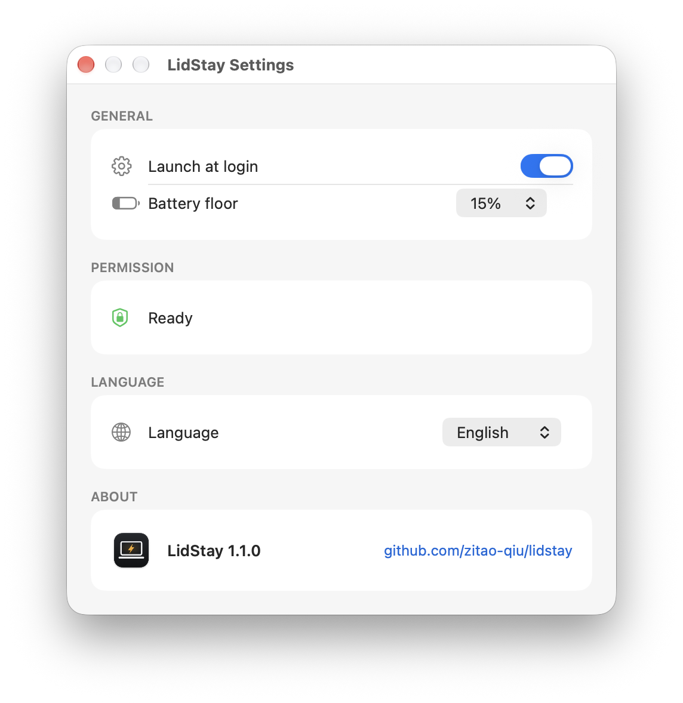

<p align="center"></p>
<h1 align="center"><a href="https://github.com/zitao-qiu/lidstay">LidStay</a></h1>
<p align="center"><strong>Keep the lid closed. Keep the job running.</strong></p>
<p align="center">
  A macOS menu-bar app that holds off lid-close sleep for one deliberate trip,<br>
  then restores normal sleep the moment you open the lid.
</p>
<p align="center">
  <a href="LICENSE"></a>
  
  
  
  
</p>
<p align="center"><b>English</b> &nbsp;·&nbsp; <a href="README.zh-CN.md">简体中文</a></p>
<p align="center">
  <a href="#why">Why</a> · <a href="#how-it-works">How it works</a> · <a href="#install">Install</a> ·
  <a href="#settings">Settings</a> · <a href="#safety">Safety</a> · <a href="#how-it-compares">Compare</a> ·
  <a href="#development">Development</a>
</p>
<p align="center"></p>

---

## Why

You start a long job — a build, a download, a render — then close the lid and leave. macOS
sleeps on lid close. That is a clamshell event from the lid sensor to `IOPMrootDomain`, not
idle sleep, so `caffeinate` and every IOKit power assertion cannot stop it: they hold off the
idle timer, they never see the lid. The one switch that does override it is the kernel's
`SleepDisabled` flag, set with `sudo pmset -a disablesleep 1`.

`disablesleep` is undocumented — not in `man pmset` — but it is the only thing that works. Left
on, it cooks a MacBook in a bag; so LidStay makes it a temporary, armed session, not a setting.

## How it works

```
          Keep running when lid closes
idle ─────────────────────────► armedOpen
  ▲                             │
  │                             │ lid closes (2 s poll)
  │                             ▼
  └───────────────────────────► armedClosed
     lid opens / battery floor / cancel / quit
```

- **Arm** → `sudo -n pmset -a disablesleep 1`, and write a marker file.
- **Disarm** → `sudo -n pmset -a disablesleep 0`, and remove it.
- The lid is read from `IOPMrootDomain` → `AppleClamshellState` every 2 seconds.
- Battery and AC state come from `IOPSGetPowerSourcesInfo`.

The marker records `armed-open` or `armed-closed`, so a watchdog can tell "the user just pressed
the button" from "the app died after the lid was shut"; otherwise it would disarm you on arm.

Headless flags:

```sh
LidStay.app/Contents/MacOS/LidStay --status   # lid, SleepDisabled, battery, marker
LidStay.app/Contents/MacOS/LidStay --arm
LidStay.app/Contents/MacOS/LidStay --disarm
```

## Install

Requires macOS 13 or later and the Swift toolchain (`xcode-select --install`); no Xcode project.

```sh
git clone https://github.com/zitao-qiu/lidstay.git
cd lidstay
make install           # build and copy LidStay.app to ~/Applications
./scripts/install.sh   # one-time: the scoped passwordless sudo rule
```

> [!IMPORTANT]
> **Why sudo?** macOS has no public API for "ignore the lid". The app flips the kernel's `SleepDisabled`
> flag through exactly two literal commands — `pmset -a disablesleep 1` and `pmset -a disablesleep 0` —
> granted by `install.sh`; sudoers matches arguments literally, so the rule cannot be widened.

<details><summary>Other ways</summary>

```sh
make              # build LidStay.app into ./build
make install      # copy it to ~/Applications
make uninstall    # remove the app
sudo rm /etc/sudoers.d/lidstay   # revoke the sudo rule
rm -rf ~/.config/lidstay         # clear the state directory
```

If the app is armed when you uninstall, disarm first (`--disarm`) or run
`sudo pmset -a disablesleep 0`.
</details>

## Settings

Open **Settings…** (⌘,) from the menu; the menu itself stays small: two status lines, the action,
battery floor, Settings, Quit.

<p align="center"></p>

- **General** — Launch at login, and the same battery floor as the menu (10–30%).
- **Permission** — a read-only status row; when the sudoers rule is missing it shows the fix.
- **Language** — System, English, or 简体中文. Applies immediately.
- **About** — version and repository.

## Safety

| Symptom | Fix |
|---|---|
| App died while armed | `sudo pmset -a disablesleep 0` |
| Keep-awake fails to arm | `./scripts/install.sh` |
| Left it armed with the lid open | `--disarm`, or just close and open the lid |

Glyphs: `laptopcomputer` idle · `bolt.fill` armed · `bolt.slash` cancel.

<details><summary>Does it work on Apple Silicon?</summary>

Yes. It is a kernel flag, not a hardware trick; if Apple ever removes it, arming fails safely.
</details>

<details><summary>Is it safe to leave the MacBook in a bag?</summary>

For a trip, yes: it ends on lid open, and at the battery floor. Never leave it armed and closed for hours.
</details>

<details><summary>What if the app crashes while armed?</summary>

`disablesleep` stays set. The `armed-closed` marker lets a watchdog finish the job; at the
keyboard, `sudo pmset -a disablesleep 0` restores sleep, and a reboot clears it.
</details>

## How it compares

| | LidStay | Sleepless | Amphetamine | `caffeinate` |
|---|:---:|:---:|:---:|:---:|
| Survives lid close | ✅ | ✅ | ⚠️ helper | ❌ |
| Ends by itself | ✅ lid opens | ✅ timer | ❌ manual | ✅ process exit |
| Battery floor | ✅ | ✅ | ✅ | ❌ |
| Open source | ✅ MIT | ✅ MIT | ❌ | Apple |
| Arm-then-close race | ✅ | n/a | n/a | n/a |

*As of 2026-11-12. Peer claims come from their READMEs, not from independent testing.*

The mechanism is the same everywhere here: `pmset disablesleep`; LidStay adds the carry-trip session.

Related: [Sleepless](https://github.com/Aboudjem/Sleepless),
[awake](https://github.com/pistachionet/awake), [Awayke](https://github.com/daemonphantom/Awayke),
[lid-awake](https://github.com/austinginder/lid-awake), [Amphetamine](https://github.com/x74353/Amphetamine).

## Development

```sh
make lint                        # swiftc -typecheck, seconds
make build && make run           # build and launch
bash .harness/hooks/verify.sh .  # doc freshness + task state
```

```
Sources/            the app, split into focused files
scripts/install.sh  scoped sudoers rule
Makefile            build / install / run / clean / lint
.harness/           specs, verification profiles, check scripts
```

The repo uses [TauLoop](https://github.com/zitao-qiu/tau-loop) for spec-driven work: start at
`AGENTS.md`, then `.harness/memory.md`. Behavior changes open a numbered spec first; `build/`
is ignored — never commit a compiled bundle.

## License

MIT — see [LICENSE](LICENSE).
