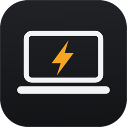
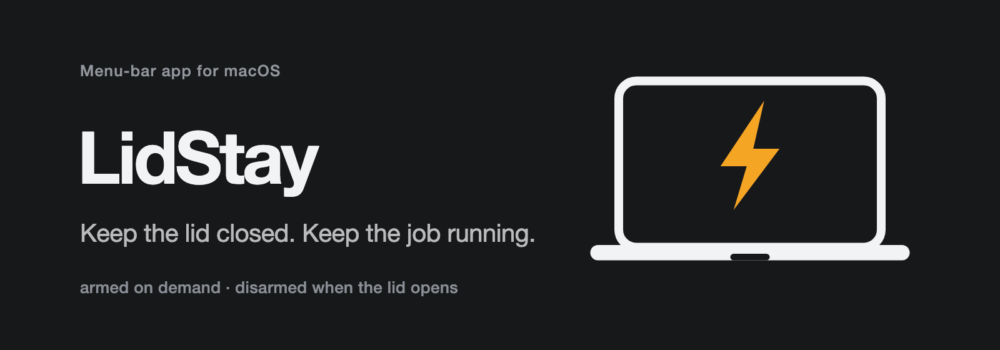
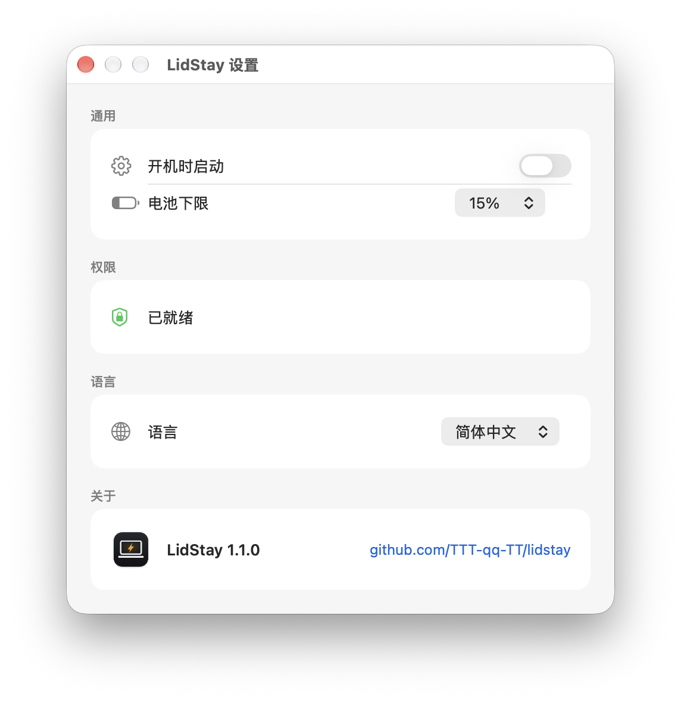

<p align="center"></p>
<h1 align="center"><a href="https://github.com/TTT-qq-TT/lidstay">LidStay</a></h1>
<p align="center"><strong>合盖不睡，任务不停。</strong></p>
<p align="center">
  一个 macOS 菜单栏小工具：为一次「带走」临时挡住合盖睡眠，<br>
  开盖那一刻恢复正常。
</p>
<p align="center">
  <a href="LICENSE"></a>
  
  
  
  
</p>
<p align="center"><a href="README.md">English</a> &nbsp;·&nbsp; <b>简体中文</b></p>
<p align="center">
  <a href="#为什么">为什么</a> · <a href="#工作方式">工作方式</a> · <a href="#安装">安装</a> ·
  <a href="#设置">设置</a> · <a href="#安全">安全</a> · <a href="#对比">对比</a> ·
  <a href="#开发">开发</a>
</p>
<p align="center"></p>

---

## 为什么

你起了一个长任务——编译、下载、渲染——然后合盖走人。macOS 合盖就睡。这不是 idle sleep，
而是盖子传感器发给 `IOPMrootDomain` 的硬件事件，所以 `caffeinate` 和任何 IOKit power
assertion 都挡不住：它们只压住 idle 计时器，根本看不到盖子。唯一能压过它的是内核的
`SleepDisabled` 标志，用 `sudo pmset -a disablesleep 1` 打开。

`disablesleep` 没有文档（`man pmset` 里没有），但确实只有它管用。一直开着也不行：一台塞在
包里的 MacBook 没有风道，只会发热、掉电；所以 LidStay 把它做成一次临时的保持运行会话，
而不是一个系统设置。

## 工作方式

```
          点「合盖后保持运行」
idle ─────────────────────────► armedOpen
  ▲                             │
  │                             │ 检测到合盖（每 2 秒轮询）
  │                             ▼
  └───────────────────────────► armedClosed
     开盖 / 触到电量下限 / 取消 / 退出
```

- **开启** → `sudo -n pmset -a disablesleep 1`，并写入标记文件。
- **取消** → `sudo -n pmset -a disablesleep 0`，删除标记文件。
- 盖子状态每 2 秒从 `IOPMrootDomain` 的 `AppleClamshellState` 读取。
- 电量与供电状态来自 `IOPSGetPowerSourcesInfo`。

标记文件记录 `armed-open` 或 `armed-closed`，看门狗因此能区分「用户刚按下按钮」和
「app 在盖子合上之后挂了」；否则它会在你刚开启时就误判。

脚本参数：

```sh
LidStay.app/Contents/MacOS/LidStay --status   # 盖子、SleepDisabled、电量、标记
LidStay.app/Contents/MacOS/LidStay --arm
LidStay.app/Contents/MacOS/LidStay --disarm
```

## 安装

需要 macOS 13 或更新版本，以及 Swift 工具链（`xcode-select --install`）；没有 Xcode 工程。

```sh
git clone https://github.com/TTT-qq-TT/lidstay.git
cd lidstay
make install           # 构建并复制 LidStay.app 到 ~/Applications
./scripts/install.sh   # 一次性：安装最小权限的免密 sudo 规则
```

> [!IMPORTANT]
> **为什么需要 sudo？** macOS 没有「忽略盖子」的公开 API。app 通过两条字面命令切换内核的
> `SleepDisabled` 标志——`pmset -a disablesleep 1` 和 `pmset -a disablesleep 0`——由
> `install.sh` 精确授权；sudoers 按字面匹配参数，规则无法被扩权。

<details><summary>其他方式</summary>

```sh
make              # 构建 LidStay.app 到 ./build
make install      # 复制到 ~/Applications
make uninstall    # 删除 app
sudo rm /etc/sudoers.d/lidstay   # 收回 sudo 规则
rm -rf ~/.config/lidstay         # 清空状态目录
```

卸载时如果正保持运行，先 `--disarm`，或者执行 `sudo pmset -a disablesleep 0`。
</details>

## 设置

从菜单打开 **设置…**（⌘,）；菜单本身保持很小：两行状态、合盖后保持运行、电池下限、
设置…、退出 LidStay。

<p align="center"></p>

- **通用** — 开机时启动，以及和菜单里同一组电池下限（10–30%）。
- **权限** — 只读状态行；sudoers 规则缺失时，它会给出修复命令。
- **语言** — 跟随系统 / English / 简体中文，立即生效。
- **关于** — 版本、仓库。

## 安全

| 症状 | 处理 |
|---|---|
| 保持运行中 app 挂了 | `sudo pmset -a disablesleep 0` |
| 开启保持运行失败 | `./scripts/install.sh` |
| 开着盖子还处于保持运行 | `--disarm`，或者合盖再开盖 |

图标：`laptopcomputer` 空闲 · `bolt.fill` 保持运行 · `bolt.slash` 取消。

<details><summary>Apple Silicon 上能用吗？</summary>

能用。它是内核标志，不是硬件技巧；如果 Apple 哪天移除，开启会安全失败。
</details>

<details><summary>放进包里安全吗？</summary>

一次外出之内是安全的：开盖即结束，电池供电时到下限也会结束。但不要让它保持运行、合着盖
在包里放几个小时。
</details>

<details><summary>app 在保持运行期间崩溃了怎么办？</summary>

`disablesleep` 会留在打开状态。`armed-closed` 标记让看门狗能替 app 收尾；人在电脑前就执行
`sudo pmset -a disablesleep 0` 恢复睡眠，重启也会清掉。
</details>

## 对比

| | LidStay | Sleepless | Amphetamine | `caffeinate` |
|---|:---:|:---:|:---:|:---:|
| 合盖有效 | ✅ | ✅ | ⚠️ 需辅助脚本 | ❌ |
| 自己结束 | ✅ 开盖即止 | ✅ 定时器 | ❌ 手动 | ✅ 进程退出 |
| 电量下限 | ✅ | ✅ | ✅ | ❌ |
| 开源 | ✅ MIT | ✅ MIT | ❌ | Apple |
| 「刚开启、盖子还开着」的竞态 | ✅ | n/a | n/a | n/a |

*截至 2026-11-12。同类项目的说法来自它们各自的 README，未经独立测试。*

底层机制和这个领域所有项目一样：`pmset disablesleep`；LidStay 加的是「带走一次」的会话模型。

同类项目：[Sleepless](https://github.com/Aboudjem/Sleepless)、
[awake](https://github.com/pistachionet/awake)、[Awayke](https://github.com/daemonphantom/Awayke)、
[lid-awake](https://github.com/austinginder/lid-awake)、[Amphetamine](https://github.com/x74353/Amphetamine)。

## 开发

```sh
make lint                        # swiftc -typecheck，几秒钟
make build && make run           # 构建并启动
bash .harness/hooks/verify.sh .  # 文档新鲜度 + 任务状态检查
```

```
Sources/            app，按职责拆成几个小文件
scripts/install.sh  最小权限 sudoers 规则
Makefile            build / install / run / clean / lint
.harness/           spec、验证配置、检查脚本
```

仓库用 [TauLoop](https://github.com/TTT-qq-TT/tau-loop) 做 spec 驱动的开发：先看 `AGENTS.md`，
再读 `.harness/memory.md`。会改变行为的改动先开编号 spec；`build/` 已被忽略。

## 许可证

MIT，见 [LICENSE](LICENSE)。
